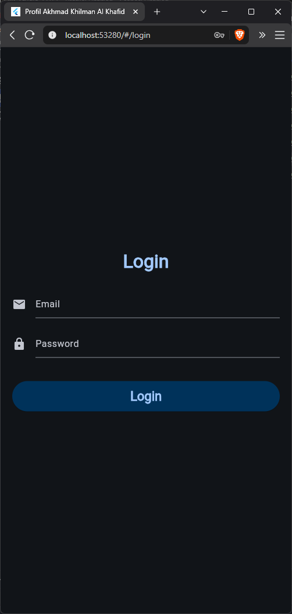
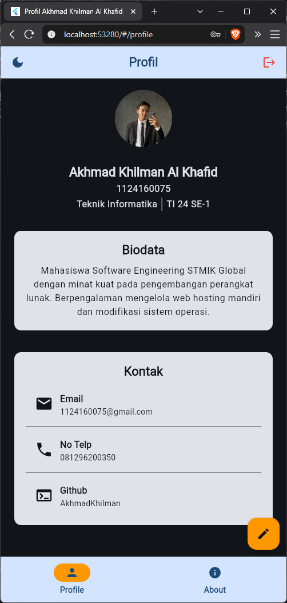
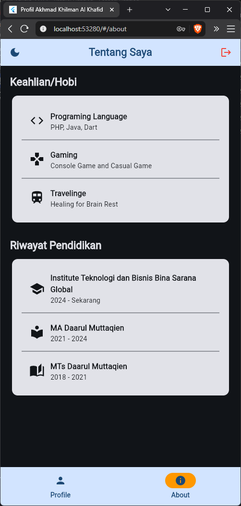

# Proyek Aplikasi Profil Flutter

## 👨‍💻 Identitas Pengembang

- **Nama** : Akhmad Khilman Al Khafid
- **NIM** : 1124160075
- **Kelas** : TI 24 SE-1
- **Program Studi** : Teknik Informatika
- **Instansi** : Institute Teknologi dan Bisnis Bina Sarana Global

## 🎥 Video Demonstrasi

▶️ **[Tonton Demo Aplikasi di YouTube](Sedang Proses...)**

## ✨ Fitur Utama

1. **Halaman Login**: Formulir autentikasi statis yang dilengkapi dengan validasi input responsif, termasuk pengecekan format email yang valid dan memastikan kolom wajib tidak dibiarkan kosong sebelum pengguna bisa masuk.
2. **Halaman Profil**: Menyajikan antarmuka yang bersih (_clean UI_) untuk menampilkan data profil pengguna, foto avatar _circular_, dan informasi kontak secara terperinci seperti Email, No Telp, dan akun Github.
3. **Halaman Edit Profil**: Formulir dinamis interaktif untuk mengubah data profil secara _real-time_. Dilengkapi dengan sistem validasi menyeluruh untuk mencegah input kosong, validasi struktur email, dan membatasi panjang input nomor telepon antara 10-13 digit. Field NIM secara otomatis dikunci (_disabled_) untuk melindungi identitas utama mahasiswa.
4. **Halaman About**: Menampilkan informasi riwayat pendidikan dan keahlian yang dikelola menggunakan struktur data _List of Map_ dan dirender ke dalam antarmuka _Card_ yang rapi.
5. **Dark Mode & Light Mode**: Aplikasi sepenuhnya mendukung pergantian tema gelap dan terang yang nyaman di mata, warna komponen akan menyesuaikan secara otomatis mengikuti pengaturan yang aktif.

## 📸 Screenshot Aplikasi

|                             Halaman Login                              |                              Halaman Profil                               |
| :--------------------------------------------------------------------: | :-----------------------------------------------------------------------: |
|  |  |

|                                 Halaman Edit Profil                                 |                      Halaman About (Tentang Saya)                      |
| :---------------------------------------------------------------------------------: | :--------------------------------------------------------------------: |
|  |  |

## 🚀 Cara Menjalankan Aplikasi (How to Run)

Berikut adalah langkah-langkah untuk menjalankan _source code_ ini di komputer lokal:

**Persyaratan Sistem:**

- Flutter SDK
- Dart SDK
- Android SDK
- Visual Studio Code / Teks Editor Lain
- Emulator Android atau _Device_ fisik yang sudah mengaktifkan _USB Debugging_.

**Langkah Instalasi kode program:**

1. Ekstrak _source code_ atau _clone repository_ ini.
2. Buka folder proyek menggunakan _text editor_ seperti VS Code.
3. Buka **Terminal** di dalam _text editor_ tersebut.
4. Jalankan perintah instalasi dependensi (untuk mengunduh _package_ yang dibutuhkan):
   ```bash
   flutter pub get
   ```

**Langkah-langkah Instalasi:**

1. Buka halaman utama _repository_ GitHub ini.
2. Pada bilah sebelah kanan, cari menu **Releases** dan klik versi terbaru (contoh: `v1.0.0`).
3. Pada bagian **Assets**, klik dan unduh file APK yang tersedia (misal: `Tugas_Akhmad_Khilman.apk`).
4. Buka file APK yang sudah diunduh di perangkat Android Anda.
5. Jika muncul peringatan keamanan, masuk ke Pengaturan HP Anda dan izinkan **"Instal dari Sumber Tidak Dikenal" (Install from Unknown Sources)**.
6. Jika muncul _pop-up_ peringatan dari Google Play Protect (karena aplikasi tidak diunduh dari Play Store), klik opsi **"More details" (Detail selengkapnya)** lalu pilih **"Install anyway" (Tetap instal)**.
7. Tunggu hingga proses instalasi selesai, dan aplikasi siap digunakan!

## 📥 Download Aplikasi

👉 **[Download profil-khilman.apk di Sini](https://github.com/AkhmadKhilman/uts-pml-1124160075/releases/latest)**
