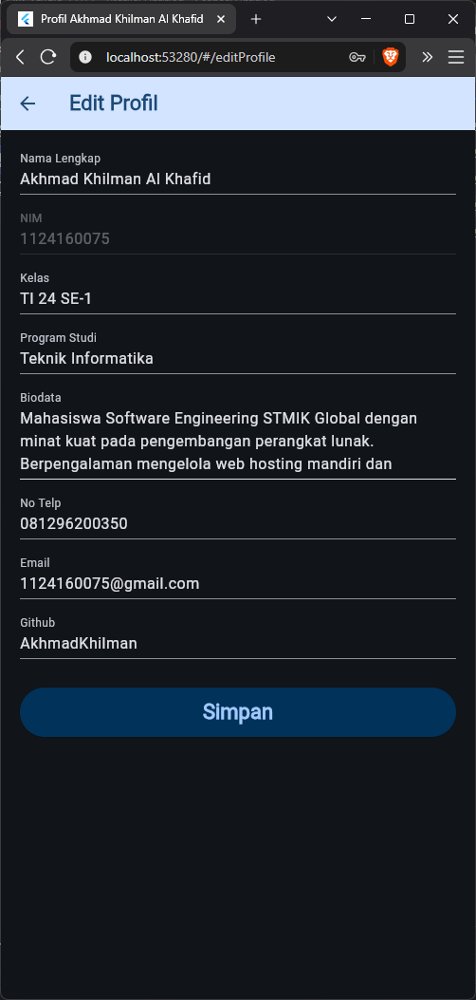

# Proyek Aplikasi Profil Flutter

Aplikasi seluler berbasis Flutter yang mengimplementasikan fitur autentikasi (Login), manajemen profil (_state management_ sederhana), dan navigasi _cross-platform_ dengan UI/UX menggunakan standar Material 3.

## 👨‍💻 Identitas Pengembang

- **Nama** : Akhmad Khilman Al Khafid
- **NIM** : 1124160075
- **Kelas** : TI 24 SE-1
- **Program Studi** : Teknik Informatika / Software Engineering
- **Instansi** : STMIK Global

## ✨ Fitur Utama

1. **Halaman Login**: Formulir autentikasi statis dengan validasi input (pengecekan format email dan minimal panjang password).
2. **Halaman Profil**: Menampilkan data profil pengguna, avatar, dan informasi kontak (Email, No Telp, Github).
3. **Halaman Edit Profil**: Formulir dinamis untuk mengubah data profil secara _real-time_. Dilengkapi dengan validasi (Cek input kosong, format email, dan batas digit nomor telepon) serta pembatasan akses edit pada field NIM.
4. **Halaman About**: Menampilkan riwayat pendidikan dan keahlian/hobi menggunakan _List of Map_ (Strongly Typed Class) dan komponen _Card_.
5. **Dark Mode & Light Mode**: Aplikasi sepenuhnya mendukung tema gelap dan terang mengikuti pengaturan sistem perangkat.

## 📸 Screenshot Aplikasi

|                             Halaman Login                              |                              Halaman Profil                               |
| :--------------------------------------------------------------------: | :-----------------------------------------------------------------------: |
|  |  |

|                                 Halaman Edit Profil                                 |                      Halaman About (Tentang Saya)                      |
| :---------------------------------------------------------------------------------: | :--------------------------------------------------------------------: |
|  |  |

_(Catatan: Letakkan gambar screenshot di folder `screenshots/` agar gambar di atas muncul)_

## 🚀 Cara Menjalankan Aplikasi (How to Run)

Berikut adalah langkah-langkah untuk menjalankan _source code_ ini di komputer lokal:

**Persyaratan Sistem:**

- Flutter SDK (Versi 3.0 ke atas)
- Dart SDK
- Visual Studio Code / Android Studio
- Emulator Android atau _Device_ fisik yang sudah mengaktifkan _USB Debugging_.

**Langkah Instalasi:**

1. Ekstrak _source code_ atau _clone repository_ ini.
2. Buka folder proyek menggunakan _text editor_ (VS Code / Android Studio).
3. Buka **Terminal** di dalam _text editor_ tersebut.
4. Jalankan perintah instalasi dependensi (untuk mengunduh _package_ yang dibutuhkan):
   ```bash
   flutter pub get
   ```
